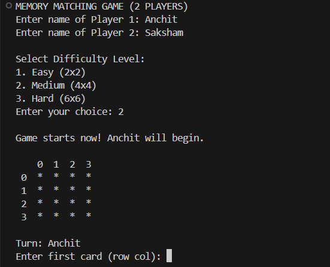
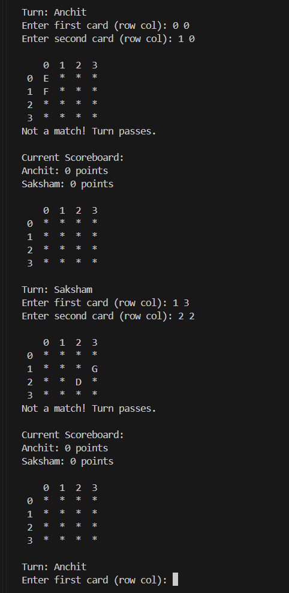
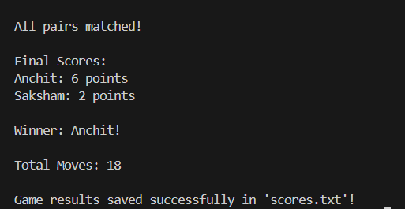

# Memory Matching Game

A two-player **console-based memory matching game written in C**. Players take turns revealing two cards by entering row and column coordinates. Matching cards remain visible and award a point; non-matching cards are hidden again and the turn passes to the other player.

## Features

- Two-player local gameplay
- Three difficulty levels:
  - Easy — 2×2 board
  - Medium — 4×4 board
  - Hard — 6×6 board
- Randomized card placement for every game
- Row/column coordinate-based card selection
- Validation for out-of-range and already-open cards
- Live scoreboard after each turn
- Total move tracking
- Winner/draw detection
- Game results appended to `scores.txt`

## Screenshots

### Game Setup



### Gameplay



### Final Result



## How It Works

1. Both players enter their names.
2. A difficulty level determines the board size.
3. Pairs of letters are generated and shuffled across the board.
4. The current player chooses two hidden cards using row and column coordinates.
5. A matching pair stays revealed and gives that player one point.
6. If the cards do not match, they are hidden again and the turn changes.
7. The game ends when every pair has been matched.
8. Final scores, winner and total moves are displayed and saved to `scores.txt`.

## Project Structure

```text
Memory-Matching-Game/
├── src/
│   └── MemoryMatchingGame.c
├── screenshots/
│   ├── game-start.png
│   ├── gameplay.png
│   └── final-result.png
├── README.md
├── LICENSE
└── .gitignore
```

## Build and Run

### Requirements

- A C compiler supporting C99 or later
- GCC/MinGW is suitable on Windows

### GCC

From the repository root:

```bash
gcc src/MemoryMatchingGame.c -o MemoryMatchingGame
```

On Windows with MinGW this creates `MemoryMatchingGame.exe`. Run it from the same terminal:

```bash
./MemoryMatchingGame.exe
```

On Linux/macOS:

```bash
./MemoryMatchingGame
```

The program creates/appends `scores.txt` in the current working directory when a game finishes. The file is intentionally ignored by Git because it contains runtime-generated results.

## Core C Concepts Used

- Two-dimensional arrays for the board
- Functions and modular program structure
- Loops and conditional statements
- Randomization with `rand()` and `srand()`
- Character arrays for player names
- File handling with `fopen`, `fprintf`, and `fclose`
- Input validation and turn-based game logic

## Notes

The current program is designed for two local players sharing the same terminal. Card values are letters, and the maximum board size is fixed at 6×6.

## License

This project is available under the MIT License.
